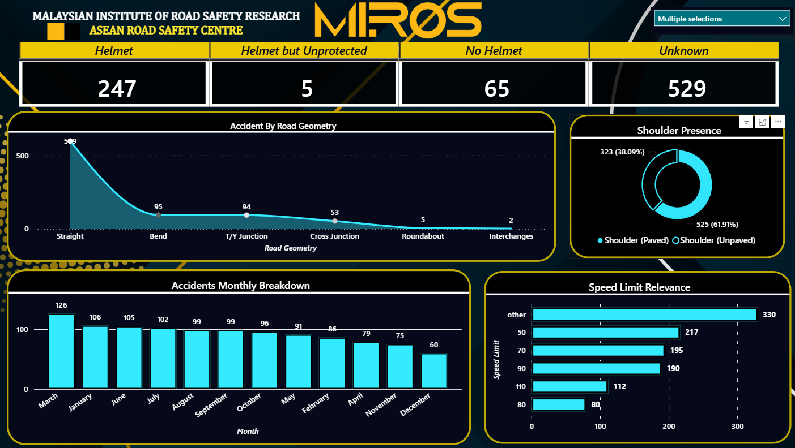

# MIROS Road Safety & Accident Dashboard

## 📌 Project Background
During my internship at the Malaysian Institute of Road Safety Research (MIROS), I developed this interactive Power BI dashboard for the ASEAN Road Safety Centre. The goal was to provide researchers and policymakers with a clear, visual tool to analyze motorcycle accident trends, helmet compliance, and environmental factors.

## 📊 Key Insights Delivered
- **Helmet Usage:** KPI cards show that out of the recorded accidents, 247 involved helmets, 65 involved no helmet, and 529 were unknown (highlighting a data collection gap).
- **Road Geometry:** A line chart reveals that the vast majority of accidents (509) occurred on straight roads, followed by bends (95).
- **Shoulder Presence:** A donut chart indicates that 61.91% of accidents occurred where there was an unpaved shoulder.
- **Monthly Breakdown:** A bar chart tracks accident frequency across the year, identifying March as the peak month.
- **Speed Limit Relevance:** A horizontal bar chart shows the distribution of accidents by speed limit, highlighting that "50 km/h" and "Other" zones had the highest frequency.

## 🎨 Design Highlights
- **Custom UI:** Built using MIROS branding (Dark Navy & Safety Amber) for a professional, executive-ready look.
- **Interactivity:** Includes a multiple-selection slicer for dynamic filtering.
- **Clear Hierarchy:** KPIs at the top, trend analysis in the middle, and granular breakdowns at the bottom.

## 📸 Dashboard Preview

## 🛠️ Tech Stack
- **Power BI Desktop**
- **DAX**
- **Power Query**

---
*Developed by Faiznajmi Bin Abd Rauf*
